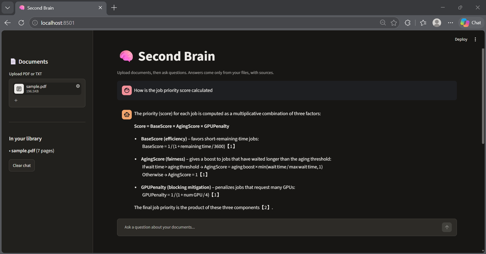
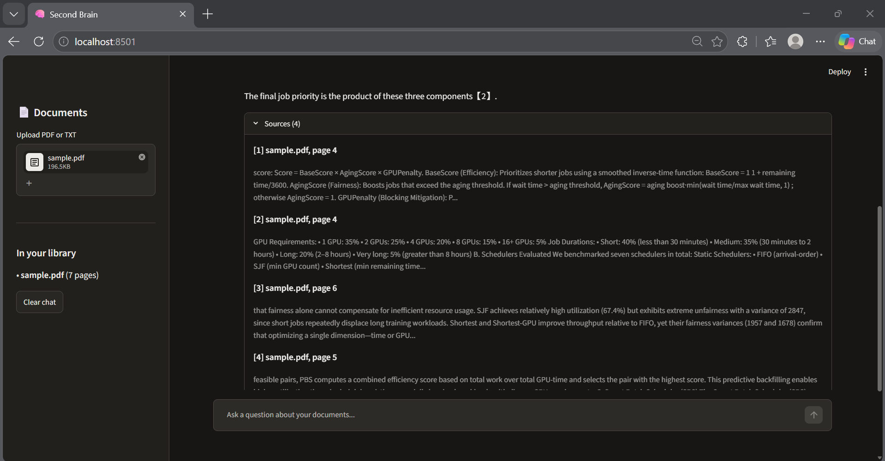
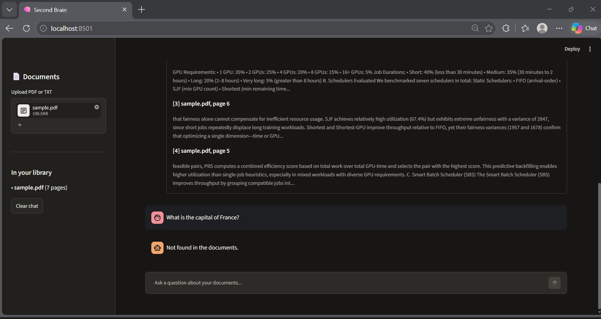
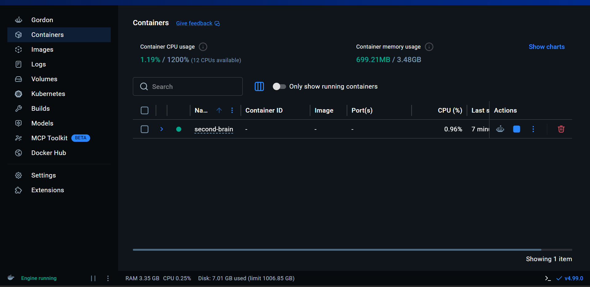

# 🧠 Second Brain: Document Q&A with RAG

Upload PDFs or TXT files and ask questions in plain English. Answers come
only from your documents, with file and page citations. If the answer isn't
in the documents, the app says so instead of guessing.






## How it works

Upload -> extract text (PyMuPDF) -> clean -> chunk (500 words, 50 overlap)
-> embed (all-MiniLM-L6-v2) -> store in ChromaDB (metadata: file, page)

Question -> embed -> retrieve top 4 chunks -> LLM answers using ONLY those
chunks -> answer + citations

- **Grounded answering:** the prompt restricts the model to the retrieved
  passages and requires the exact reply "Not found in the documents." when the
  answer is missing.
- **Citations:** every chunk keeps its file name and page number, shown under
  each answer.

## Tech stack

Python, PyMuPDF, sentence-transformers, ChromaDB, FastAPI, Streamlit,
Groq API (open-weight LLM, free tier), Docker, Docker Compose

## Results

Evaluated on 30 hand-checked questions (24 answerable, 6 unanswerable) about
one research paper (a 7-page paper on GPU cluster scheduling).

| Chunk size (words) | Chunks | Hit rate @4 | MRR   |
|--------------------|--------|-------------|-------|
| 300                | 20     | 79.2%       | 0.642 |
| **500**            | 14     | **91.7%**   | 0.736 |
| 800                | 8      | 62.5%       | 0.493 |

- **"Not found" accuracy:** 6/6 unanswerable questions correctly refused
- **Answer correctness:** 87.5% (21/24, checked manually). All 3 errors were
  wrongful refusals, not made-up answers.
- **Average latency:** about 8.9 s per question (free API tier, includes
  rate-limit retries)

Hit rate @4 = how often the page containing the answer is among the 4
retrieved chunks. MRR = how high the correct page ranks on average.

## Run with Docker (recommended)

Requires Docker Desktop.

1. Create a `.env` file in the project root:

   ```
   GROQ_API_KEY=your_key_here
   ```

2. Build and start the API and UI:

   ```
   docker compose up --build
   ```

3. Open http://localhost:8501 (API docs at http://localhost:8000/docs)

To stop: press Ctrl + C, then run `docker compose down`.
Later runs only need `docker compose up`. Uploaded files and the vector
database are stored in the local `data/` folder, so they survive restarts.

## Run locally (without Docker)

1. Install libraries:

   ```
   pip install fastapi uvicorn pymupdf sentence-transformers chromadb streamlit requests python-multipart openai python-dotenv
   ```

2. Get a free API key at console.groq.com and create a `.env` file:

   ```
   GROQ_API_KEY=your_key_here
   ```

3. Start the API (terminal 1): `uvicorn api.main:app --reload`
4. Start the UI (terminal 2): `streamlit run ui/app.py`
5. Open http://localhost:8501

Run the evaluation: `python -m eval.evaluate`

## Project structure

```
ingest/   extract.py, chunk.py
rag/      embed.py, retrieve.py, answer.py
api/      main.py
ui/       app.py
eval/     questions.json, evaluate.py
Dockerfile, docker-compose.yml, requirements.txt
```

## Limitations

- Text-based PDFs only (no OCR for scanned pages)
- Tables and multi-column layouts may extract poorly
- Chunks never cross page boundaries, so facts spanning two pages can be missed
- Evaluated on a single document with a small question set
- The model sometimes refuses answerable questions (3/24 in my test)

## Future work

Hybrid keyword + vector search, reranking, OCR for scanned PDFs.